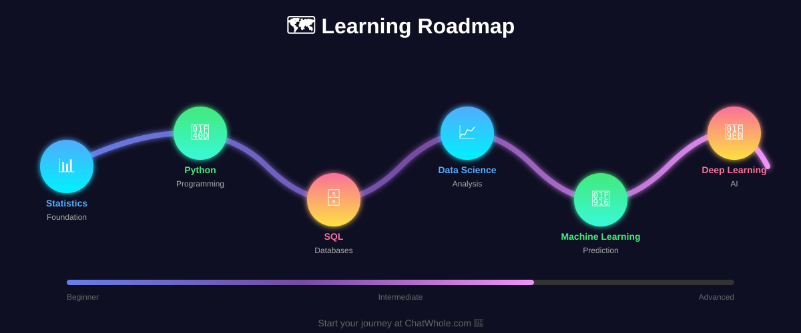
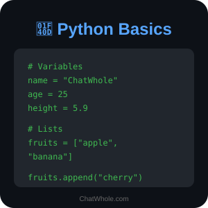
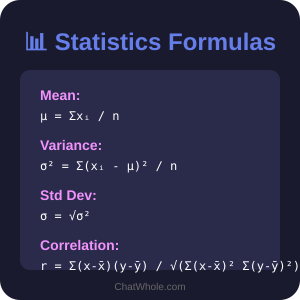
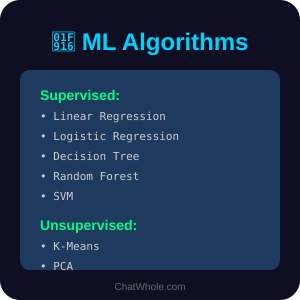

# 🚀 Data Science & AI Complete Learning Hub

<p align="center">
  
</p>

<p align="center">
  <strong>🎯 Master Data Science, AI & Machine Learning with Beautiful Visual Cheat Sheets</strong>
</p>

<p align="center">
  <a href="https://chatwhole.com">🌐 Visit ChatWhole.com</a> • 
  <a href="https://chatwhole.com/learn/data-science/">📊 Data Science Tutorials</a> • 
  <a href="https://chatwhole.com/learn/python/">🐍 Python Guides</a> • 
  <a href="https://chatwhole.com/learn/machine-learning/">🤖 ML Resources</a>
</p>

---

## 📚 Complete Learning Roadmap

<p align="center">
  
</p>

### 🎯 Quick Navigation

| Topic | Level | Cheat Sheet | Tutorial | Website |
|-------|-------|-------------|----------|---------|
| 📊 **Statistics** | Beginner → Advanced | [View SVG](statistics/statistics-cheat-sheet.svg) | [README](statistics/README.md) | [ChatWhole](https://chatwhole.com/learn/statistics/) |
| 🐍 **Python** | Beginner → Advanced | [View SVG](python/python-cheat-sheet.svg) | [README](python/README.md) | [ChatWhole](https://chatwhole.com/learn/python/) |
| 🤖 **Machine Learning** | Intermediate → Advanced | [View SVG](machine-learning/ml-cheat-sheet.svg) | [README](machine-learning/README.md) | [ChatWhole](https://chatwhole.com/learn/machine-learning/) |
| 🧠 **Deep Learning** | Advanced | [View SVG](deep-learning/deep-learning-cheat-sheet.svg) | [README](deep-learning/README.md) | [ChatWhole](https://chatwhole.com/learn/deep-learning/) |
| 📈 **Data Science** | All Levels | [View SVG](data-science/data-science-cheat-sheet.svg) | [README](data-science/README.md) | [ChatWhole](https://chatwhole.com/learn/data-science/) |
| 🗄️ **SQL** | Beginner → Advanced | [View SVG](sql/sql-cheat-sheet.svg) | [README](sql/README.md) | [ChatWhole](https://chatwhole.com/learn/sql/) |
| 📊 **Data Visualization** | Beginner → Advanced | [View SVG](data-visualization/dataviz-cheat-sheet.svg) | [README](data-visualization/README.md) | [Data Viz Guide](data-visualization/README.md) |
| 📡 **Apache Kafka** | Beginner → Advanced | — | [README](kafka/README.md) | [ChatWhole](https://chatwhole.com/learn/kafka/) |
| ✨ **Generative AI** | Intermediate → Advanced | — | [README](generative-ai/README.md) | [ChatWhole](https://chatwhole.com/learn/generative-ai/) |
| 🧠 **Large Language Models** | Intermediate → Advanced | — | [README](llm/README.md) | [ChatWhole](https://chatwhole.com/learn/llm/) |
| 🤖 **AI Agents** | Intermediate → Advanced | — | [README](ai-agents/README.md) | [ChatWhole](https://chatwhole.com/learn/ai-agents/) |
| 🏗️ **AI System Design** | Advanced | — | [README](ai-system-design/README.md) | [ChatWhole](https://chatwhole.com/learn/ai-system-design/) |
| ❄️ **Snowflake** | Beginner → Advanced | — | [README](snowflake/README.md) | [ChatWhole](https://chatwhole.com/learn/snowflake/) |
| 🔥 **PySpark** | Intermediate → Advanced | — | [README](pyspark/README.md) | [ChatWhole](https://chatwhole.com/learn/pyspark/) |
| 📊 **Data Analytics** | Beginner → Advanced | — | [README](data-analytics/README.md) | [ChatWhole](https://chatwhole.com/learn/data-analytics/) |
| 🏥 **Healthcare AI** | Intermediate → Advanced | — | [README](healthcare-ai/README.md) | [ChatWhole](https://chatwhole.com/learn/healthcare-ai/) |
| 🛸 **Drone AI** | Intermediate → Advanced | — | [README](drone-ai/README.md) | [ChatWhole](https://chatwhole.com/learn/drone-ai/) |
| 💹 **Fintech** | Intermediate → Advanced | — | [README](fintech/README.md) | [ChatWhole](https://chatwhole.com/learn/fintech/) |
| ⚛️ **React** | Beginner → Advanced | — | [README](react/README.md) | [ChatWhole](https://chatwhole.com/learn/react/) |
| 🔬 **Quantum Computing** | Intermediate → Advanced | — | [README](quantum-computing/README.md) | [ChatWhole](https://chatwhole.com/learn/quantum-computing/) |
| 📐 **Mathematics** | Beginner → Advanced | — | [README](math/README.md) | [ChatWhole](https://chatwhole.com/learn/math/) |
| 🎓 **CBSE Class 11 Maths** | School | — | [README](cbse-class11/README.md) | [ChatWhole](https://chatwhole.com/learn/cbse-class11/) |
| 💻 **C Programming** | Beginner → Advanced | — | [README](c/README.md) | [ChatWhole](https://chatwhole.com/learn/c/) |
| 💠 **C# Programming** | Beginner → Advanced | — | [README](csharp/README.md) | [ChatWhole](https://chatwhole.com/learn/csharp/) |
| 📈 **R Programming** | Beginner → Advanced | — | [README](r/README.md) | [ChatWhole](https://chatwhole.com/learn/r/) |
| ⚙️ **Mechanical Engineering** | Beginner → Advanced | — | [README](mechanical-engineering/README.md) | [ChatWhole](https://chatwhole.com/learn/mechanical-engineering/) |
| ⚡ **Electrical Engineering** | Beginner → Advanced | — | [README](electrical-engineering/README.md) | [ChatWhole](https://chatwhole.com/learn/electrical-engineering/) |
| 🔌 **Power Electronics** | Intermediate → Advanced | — | [README](power-electronics/README.md) | [ChatWhole](https://chatwhole.com/learn/power-electronics/) |
| 🎛️ **Control Systems** | Intermediate → Advanced | — | [README](control-systems/README.md) | [ChatWhole](https://chatwhole.com/learn/control-systems/) |
| 🔄 **Electrical Machines** | Intermediate → Advanced | — | [README](electrical-machines/README.md) | [ChatWhole](https://chatwhole.com/learn/electrical-machines/) |
| 🖥️ **Embedded Systems** | Intermediate → Advanced | — | [README](embedded-systems/README.md) | [ChatWhole](https://chatwhole.com/learn/embedded-systems/) |
| 🌱 **Renewable Energy Systems** | Intermediate → Advanced | — | [README](renewable-energy-systems/README.md) | [ChatWhole](https://chatwhole.com/learn/renewable-energy-systems/) |
| 📏 **Electrical Instrumentation** | Intermediate → Advanced | — | [README](electrical-instrumentation/README.md) | [ChatWhole](https://chatwhole.com/learn/electrical-instrumentation/) |
| 🔋 **High Voltage Engineering** | Intermediate → Advanced | — | [README](high-voltage-engineering/README.md) | [ChatWhole](https://chatwhole.com/learn/high-voltage-engineering/) |

---

## 🌟 Featured SVG Cheat Sheets

<p align="center">
  
  
  
</p>

---

## 📖 How to Use This Repository

### 🎓 For Beginners
1. Start with **[Statistics](statistics/README.md)** - Foundation of Data Science
2. Learn **[Python](python/README.md)** - The programming language
3. Practice **[SQL](sql/README.md)** - Database querying

### 🚀 For Intermediate
4. Master **[Data Science](data-science/README.md)** - Complete pipeline
5. Explore **[Data Visualization](data-visualization/README.md)** - Storytelling with data
6. Build **[Machine Learning](machine-learning/README.md)** - Predictive models

### 🧠 For Advanced
7. Dive into **[Deep Learning](deep-learning/README.md)** - Neural networks & AI

---

## 🔗 Important Links

<p align="center">
  <a href="https://chatwhole.com">
    
  </a>
</p>

| Resource | Description | Link |
|----------|-------------|------|
| 🌐 **ChatWhole.com** | Main Website & Tutorials | [Visit](https://chatwhole.com) |
| 📊 **Data Science Course** | Complete Data Science Bootcamp | [Start Learning](https://chatwhole.com/learn/data-science/) |
| 🐍 **Python Tutorial** | Python for Data Science | [Learn Python](https://chatwhole.com/learn/python/) |
| 🤖 **ML Course** | Machine Learning Masterclass | [Master ML](https://chatwhole.com/learn/machine-learning/) |
| 🧠 **DL Course** | Deep Learning Specialization | [Deep Dive](https://chatwhole.com/learn/deep-learning/) |
| 📈 **Statistics Course** | Statistics Fundamentals | [Study Stats](https://chatwhole.com/learn/statistics/) |
| 🗄️ **SQL Course** | Database Mastery | [Query Data](https://chatwhole.com/learn/sql/) |
| 📡 **Apache Kafka Course** | Event streaming tutorial series | [Start Learning](https://chatwhole.com/learn/kafka/) |
| ✨ **Generative AI Course** | Diffusion, transformers & RAG | [Start Learning](https://chatwhole.com/learn/generative-ai/) |
| 🧠 **LLM Course** | Large language models end-to-end | [Start Learning](https://chatwhole.com/learn/llm/) |
| 🤖 **AI Agents Course** | Build production AI agents | [Start Learning](https://chatwhole.com/learn/ai-agents/) |
| 🏗️ **AI System Design Course** | ML system design & interviews | [Start Learning](https://chatwhole.com/learn/ai-system-design/) |
| ❄️ **Snowflake Course** | Cloud data warehouse mastery | [Start Learning](https://chatwhole.com/learn/snowflake/) |
| 🔥 **PySpark Course** | Spark performance & streaming | [Start Learning](https://chatwhole.com/learn/pyspark/) |
| 📊 **Data Analytics Course** | Analytics, BI & modern data stack | [Start Learning](https://chatwhole.com/learn/data-analytics/) |
| 🏥 **Healthcare AI Course** | Medical imaging, clinical NLP & genomics | [Start Learning](https://chatwhole.com/learn/healthcare-ai/) |
| 🛸 **Drone AI Course** | Computer vision, SLAM & autonomous navigation | [Start Learning](https://chatwhole.com/learn/drone-ai/) |
| 💹 **Fintech Course** | Trading, risk, payments & financial AI | [Start Learning](https://chatwhole.com/learn/fintech/) |
| ⚛️ **React Course** | Hooks, state & production React apps | [Start Learning](https://chatwhole.com/learn/react/) |
| 🔬 **Quantum Computing Course** | Qubits, algorithms & QML | [Start Learning](https://chatwhole.com/learn/quantum-computing/) |
| 📐 **Mathematics Course** | Linear algebra, calculus & probability | [Start Learning](https://chatwhole.com/learn/math/) |
| 🎓 **CBSE Class 11 Maths** | NCERT-aligned school mathematics | [Start Learning](https://chatwhole.com/learn/cbse-class11/) |
| 💻 **C Programming Course** | Pointers, memory & data structures | [Start Learning](https://chatwhole.com/learn/c/) |
| 💠 **C# Programming Course** | OOP, LINQ, async & Web API | [Start Learning](https://chatwhole.com/learn/csharp/) |
| 📈 **R Programming Course** | dplyr, ggplot2, stats & Shiny | [Start Learning](https://chatwhole.com/learn/r/) |
| ⚙️ **Mechanical Engineering** | Mechanics, thermodynamics & manufacturing | [Start Learning](https://chatwhole.com/learn/mechanical-engineering/) |
| ⚡ **Electrical Engineering** | Circuits, machines & power systems | [Start Learning](https://chatwhole.com/learn/electrical-engineering/) |
| 🔌 **Power Electronics Course** | Converters, inverters & magnetics | [Start Learning](https://chatwhole.com/learn/power-electronics/) |
| 🎛️ **Control Systems Course** | PID, root locus & state space | [Start Learning](https://chatwhole.com/learn/control-systems/) |
| 🔄 **Electrical Machines Course** | Motors, transformers & fault diagnosis | [Start Learning](https://chatwhole.com/learn/electrical-machines/) |
| 🖥️ **Embedded Systems Course** | RTOS, Embedded C & TinyML | [Start Learning](https://chatwhole.com/learn/embedded-systems/) |
| 🌱 **Renewable Energy Systems** | Solar PV, wind, storage & microgrids | [Start Learning](https://chatwhole.com/learn/renewable-energy-systems/) |
| 📏 **Electrical Instrumentation** | Transducers, DAQ & calibration | [Start Learning](https://chatwhole.com/learn/electrical-instrumentation/) |
| 🔋 **High Voltage Engineering** | Dielectrics, partial discharge & HVDC | [Start Learning](https://chatwhole.com/learn/high-voltage-engineering/) |

---

## ❓ Frequently Asked Questions (FAQ)

**Q: What is ChatWhole Learning Hub?**
A free open-source collection of 1,360 lesson indexes across 29 courses spanning data science, AI, engineering, programming and school mathematics — published on GitHub and linked to free lessons on [ChatWhole.com](https://chatwhole.com).

**Q: How do I find free machine learning tutorials?**
Start at the [Machine Learning course index](machine-learning/README.md) — 51 lessons from linear regression to transformers, MLOps and causal inference. All lessons are free; no signup required.

**Q: Which courses are best for beginners?**
[Statistics](https://chatwhole.com/learn/statistics/) → [Python](https://chatwhole.com/learn/python/) → [SQL](https://chatwhole.com/learn/sql/) → [Data Analytics](https://chatwhole.com/learn/data-analytics/). For programming foundations try [C](https://chatwhole.com/learn/c/), [C#](https://chatwhole.com/learn/csharp/), [R](https://chatwhole.com/learn/r/) or [React](https://chatwhole.com/learn/react/).

**Q: Are there industry-specific AI courses?**
Yes: [Healthcare AI](https://chatwhole.com/learn/healthcare-ai/), [Fintech](https://chatwhole.com/learn/fintech/), [Drone AI](https://chatwhole.com/learn/drone-ai/) and [Quantum Computing](https://chatwhole.com/learn/quantum-computing/) — 45-50 lessons each.

**Q: Does ChatWhole cover engineering subjects?**
Yes — nine 30-lesson engineering courses: [Mechanical](https://chatwhole.com/learn/mechanical-engineering/), [Electrical](https://chatwhole.com/learn/electrical-engineering/), [Power Electronics](https://chatwhole.com/learn/power-electronics/), [Control Systems](https://chatwhole.com/learn/control-systems/), [Electrical Machines](https://chatwhole.com/learn/electrical-machines/), [Embedded Systems](https://chatwhole.com/learn/embedded-systems/), [Renewable Energy](https://chatwhole.com/learn/renewable-energy-systems/), [Instrumentation](https://chatwhole.com/learn/electrical-instrumentation/) and [High Voltage](https://chatwhole.com/learn/high-voltage-engineering/).

**Q: Is there CBSE or school-level content?**
Yes — [CBSE Class 11 Mathematics](https://chatwhole.com/learn/cbse-class11/) with 81 lessons covering trigonometry, algebra, coordinate geometry, calculus, probability and statistics.

**Q: Is everything free?**
Yes — all 1,360 lessons are free to read on ChatWhole.com and free to clone from GitHub. No account or signup is required.

---

## 📥 Download All Cheat Sheets

Download all SVG cheat sheets as a zip:

```bash
git clone https://github.com/chatwhole/learning-hub.git
cd learning-hub/github_content
```

---

## 🤝 Contributing

We welcome contributions! Please read our [Contributing Guidelines](CONTRIBUTING.md) first.

## 📄 License

This project is licensed under the MIT License - see the [LICENSE](LICENSE) file for details.

---

<p align="center">
  Made with ❤️ by <a href="https://chatwhole.com">ChatWhole.com</a>
</p>

<p align="center">
  
</p>
