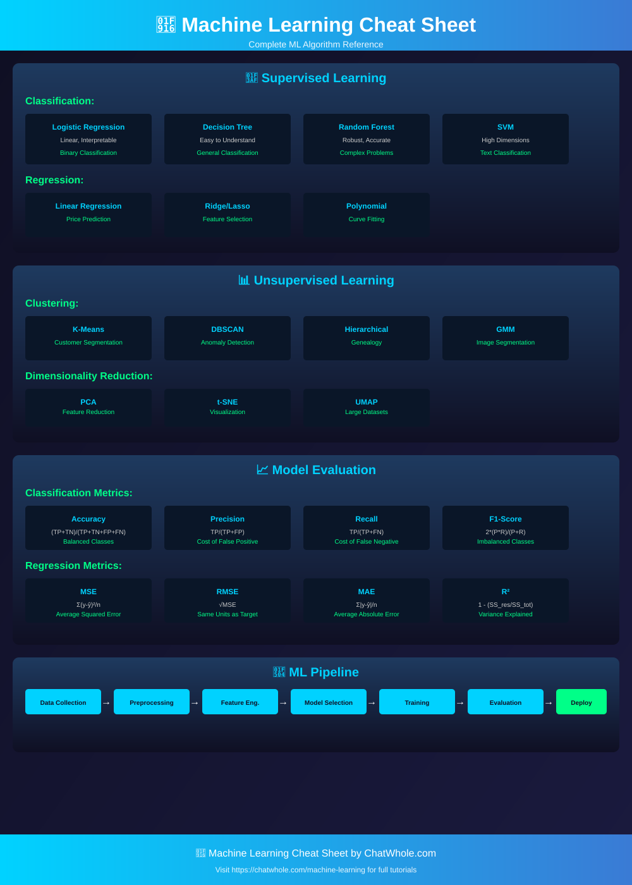

# 🤖 Machine Learning

<p align="center">
  
</p>

## 📚 Table of Contents

1. [Supervised Learning](#supervised-learning)
2. [Unsupervised Learning](#unsupervised-learning)
3. [Model Evaluation](#model-evaluation)
4. [Feature Engineering](#feature-engineering)
5. [Full Course Lesson Index](#full-course-lesson-index)

---

## 🎯 Supervised Learning

### Classification Algorithms

| Algorithm | Pros | Cons | Use Case |
|-----------|------|------|----------|
| **Logistic Regression** | Simple, interpretable | Linear boundaries | Binary classification |
| **Decision Tree** | Easy to understand | Overfitting | General classification |
| **Random Forest** | Robust, accurate | Less interpretable | Complex problems |
| **SVM** | Effective in high dims | Slow on large data | Text classification |
| **KNN** | Simple, no training | Slow prediction | Small datasets |
| **Naive Bayes** | Fast, works well | Independence assumption | Spam filtering |

### Regression Algorithms

| Algorithm | Pros | Cons | Use Case |
|-----------|------|------|----------|
| **Linear Regression** | Simple, interpretable | Assumes linearity | Price prediction |
| **Ridge/Lasso** | Handles multicollinearity | Less interpretable | Feature selection |
| **Polynomial** | Captures non-linearity | Overfitting risk | Curve fitting |
| **SVR** | Robust to outliers | Computationally expensive | Complex regression |

---

## 📊 Unsupervised Learning

### Clustering

| Algorithm | Pros | Cons | Use Case |
|-----------|------|------|----------|
| **K-Means** | Fast, scalable | Must specify k | Customer segmentation |
| **DBSCAN** | Finds任意形状 | Sensitive to params | Anomaly detection |
| **Hierarchical** | No need to specify k | Computationally expensive | Genealogy |
| **GMM** | Soft clustering | Assumes Gaussian | Image segmentation |

### Dimensionality Reduction

| Algorithm | Pros | Cons | Use Case |
|-----------|------|------|----------|
| **PCA** | Preserves variance | Linear only | Feature reduction |
| **t-SNE** | Preserves local structure | Non-parametric | Visualization |
| **UMAP** | Fast, scalable | Requires tuning | Large datasets |

---

## 📈 Model Evaluation

### Classification Metrics

| Metric | Formula | When to Use |
|--------|---------|-------------|
| **Accuracy** | (TP+TN)/(TP+TN+FP+FN) | Balanced classes |
| **Precision** | TP/(TP+FP) | Cost of false positive high |
| **Recall** | TP/(TP+FN) | Cost of false negative high |
| **F1-Score** | 2*(P*R)/(P+R) | Imbalanced classes |
| **AUC-ROC** | Area under ROC curve | Overall performance |

### Regression Metrics

| Metric | Formula | Interpretation |
|--------|---------|----------------|
| **MSE** | Σ(y-ŷ)²/n | Average squared error |
| **RMSE** | √MSE | Same units as target |
| **MAE** | Σ|y-ŷ|/n | Average absolute error |
| **R²** | 1 - (SS_res/SS_tot) | Variance explained |

### Cross-Validation

```python
from sklearn.model_selection import cross_val_score

scores = cross_val_score(model, X, y, cv=5)
print(f"Accuracy: {scores.mean():.2f} (+/- {scores.std():.2f})")
```

---

## 🔧 Feature Engineering

### Common Techniques

| Technique | Description | When to Use |
|-----------|-------------|-------------|
| **Scaling** | Normalize features | Distance-based algorithms |
| **Encoding** | Convert categories | Categorical features |
| **Imputation** | Handle missing values | Missing data |
| **Feature Selection** | Remove irrelevant features | High dimensionality |
| **Polynomial Features** | Create interaction terms | Non-linear relationships |

### Scaling Methods

```python
from sklearn.preprocessing import StandardScaler, MinMaxScaler

# StandardScaler (z-score)
scaler = StandardScaler()
X_scaled = scaler.fit_transform(X)

# MinMaxScaler (0-1)
scaler = MinMaxScaler()
X_scaled = scaler.fit_transform(X)
```

---

## 🔄 ML Pipeline

```
Data Collection → Preprocessing → Feature Engineering → Model Selection → Training → Evaluation → Deployment
```

---

## 🎓 Full Course Lesson Index

Follow the complete **51-lesson Machine Learning course** on ChatWhole.com — every lesson linked below.

### Part 1 — Foundations & Classical ML (01–20)

| # | Lesson |
|---|--------|
| 01 | [What Is Machine Learning](https://chatwhole.com/learn/machine-learning/01-what-is-machine-learning/) |
| 02 | [Math Foundations](https://chatwhole.com/learn/machine-learning/02-math-foundations/) |
| 03 | [Linear Regression](https://chatwhole.com/learn/machine-learning/03-linear-regression/) |
| 04 | [Logistic Regression](https://chatwhole.com/learn/machine-learning/04-logistic-regression/) |
| 05 | [KNN](https://chatwhole.com/learn/machine-learning/05-knn/) |
| 06 | [Decision Trees](https://chatwhole.com/learn/machine-learning/06-decision-trees/) |
| 07 | [Naive Bayes](https://chatwhole.com/learn/machine-learning/07-naive-bayes/) |
| 08 | [SVM](https://chatwhole.com/learn/machine-learning/08-svm/) |
| 09 | [Clustering](https://chatwhole.com/learn/machine-learning/09-clustering/) |
| 10 | [Model Evaluation](https://chatwhole.com/learn/machine-learning/10-model-evaluation/) |
| 11 | [Random Forest](https://chatwhole.com/learn/machine-learning/11-random-forest/) |
| 12 | [XGBoost](https://chatwhole.com/learn/machine-learning/12-xgboost/) |
| 13 | [Feature Engineering](https://chatwhole.com/learn/machine-learning/13-feature-engineering/) |
| 14 | [Dimensionality Reduction](https://chatwhole.com/learn/machine-learning/14-dimensionality-reduction/) |
| 15 | [Model Selection](https://chatwhole.com/learn/machine-learning/15-model-selection/) |
| 16 | [Regularization](https://chatwhole.com/learn/machine-learning/16-regularization/) |
| 17 | [Ensemble Methods](https://chatwhole.com/learn/machine-learning/17-ensemble-methods/) |
| 18 | [Time Series](https://chatwhole.com/learn/machine-learning/18-time-series/) |
| 19 | [NLP Fundamentals](https://chatwhole.com/learn/machine-learning/19-nlp-fundamentals/) |
| 20 | [Recommendation Systems](https://chatwhole.com/learn/machine-learning/20-recommendation-systems/) |

### Part 2 — Deep Learning & Generative AI (21–32)

| # | Lesson |
|---|--------|
| 21 | [Neural Networks](https://chatwhole.com/learn/machine-learning/21-neural-networks/) |
| 22 | [CNN](https://chatwhole.com/learn/machine-learning/22-cnn/) |
| 23 | [RNN & LSTM](https://chatwhole.com/learn/machine-learning/23-rnn-lstm/) |
| 24 | [GANs](https://chatwhole.com/learn/machine-learning/24-gans/) |
| 25 | [Transformers](https://chatwhole.com/learn/machine-learning/25-transformers/) |
| 26 | [BERT](https://chatwhole.com/learn/machine-learning/26-bert/) |
| 27 | [Transfer Learning](https://chatwhole.com/learn/machine-learning/27-transfer-learning/) |
| 28 | [Autoencoders](https://chatwhole.com/learn/machine-learning/28-autoencoders/) |
| 29 | [Attention Deep Dive](https://chatwhole.com/learn/machine-learning/29-attention-deep-dive/) |
| 30 | [Training Deep Networks](https://chatwhole.com/learn/machine-learning/30-training-deep-networks/) |
| 31 | [GPT Architecture](https://chatwhole.com/learn/machine-learning/31-gpt-architecture/) |
| 32 | [Reinforcement Learning](https://chatwhole.com/learn/machine-learning/32-reinforcement-learning/) |

### Part 3 — Production ML & Advanced Topics (33–40)

| # | Lesson |
|---|--------|
| 33 | [MLOps](https://chatwhole.com/learn/machine-learning/33-mlops/) |
| 34 | [Model Deployment](https://chatwhole.com/learn/machine-learning/34-model-deployment/) |
| 35 | [A/B Testing](https://chatwhole.com/learn/machine-learning/35-a-b-testing/) |
| 36 | [ML Ethics](https://chatwhole.com/learn/machine-learning/36-ml-ethics/) |
| 37 | [Interpretability](https://chatwhole.com/learn/machine-learning/37-interpretability/) |
| 38 | [Causal Inference](https://chatwhole.com/learn/machine-learning/38-causal-inference/) |
| 39 | [Graph Neural Networks](https://chatwhole.com/learn/machine-learning/39-graph-neural-networks/) |
| 40 | [Diffusion Models](https://chatwhole.com/learn/machine-learning/40-diffusion-models/) |

### Part 4: Lessons 41-51

| # | Lesson |
|---|--------|
| 41 | [Federated Learning](https://chatwhole.com/learn/machine-learning/41-federated-learning/) |
| 42 | [Meta Learning](https://chatwhole.com/learn/machine-learning/42-meta-learning/) |
| 43 | [Self-Supervised Learning](https://chatwhole.com/learn/machine-learning/43-self-supervised-learning/) |
| 44 | [AutoML](https://chatwhole.com/learn/machine-learning/44-automl/) |
| 45 | [ML System Design](https://chatwhole.com/learn/machine-learning/45-ml-system-design/) |
| 46 | [Feature Stores](https://chatwhole.com/learn/machine-learning/46-feature-stores/) |
| 47 | [Research Methods](https://chatwhole.com/learn/machine-learning/47-research-methods/) |
| 48 | [Capstone Projects](https://chatwhole.com/learn/machine-learning/48-capstone-projects/) |
| 49 | [ML Interview Prep](https://chatwhole.com/learn/machine-learning/49-ml-interview-prep/) |
| 50 | [Cheat Sheet](https://chatwhole.com/learn/machine-learning/50-cheatsheet/) |
| 51 | [Linear Models](https://chatwhole.com/learn/machine-learning/51-linear-models/) |

---

## 🔗 Related Resources

| Resource | Link |
|----------|------|
| 🤖 Machine Learning Tutorial | [ChatWhole.com/learn/machine-learning](https://chatwhole.com/learn/machine-learning/) |
| 🧠 Deep Learning | [ChatWhole.com/learn/deep-learning](https://chatwhole.com/learn/deep-learning/) |
| 🐍 Python for ML | [ChatWhole.com/learn/python](https://chatwhole.com/learn/python/) |
| 📡 Kafka: Microservices | [ChatWhole.com/learn/kafka/13-kafka-microservices](https://chatwhole.com/learn/kafka/13-kafka-microservices/) |
| 📡 Kafka: Kubernetes | [ChatWhole.com/learn/kafka/14-kafka-kubernetes](https://chatwhole.com/learn/kafka/14-kafka-kubernetes/) |
| 📐 Mathematics for ML | [math/README.md](../math/README.md) |
| 💹 Fintech ML | [fintech/README.md](../fintech/README.md) |
| 🛸 Drone AI | [drone-ai/README.md](../drone-ai/README.md) |
| 🔬 Quantum ML | [quantum-computing/README.md](../quantum-computing/README.md) |
| 🏥 Healthcare AI | [healthcare-ai/README.md](../healthcare-ai/README.md) |

---

<p align="center">
  <a href="https://chatwhole.com">← Back to ChatWhole.com</a>
</p>
